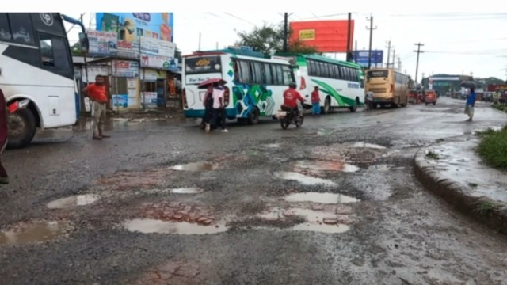
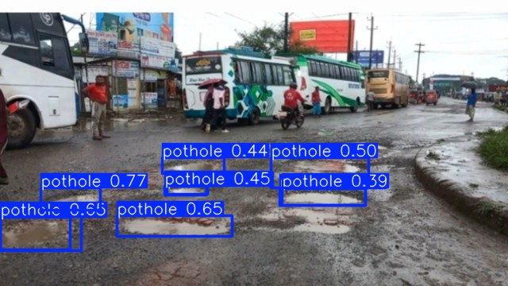
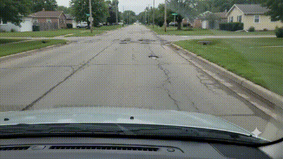
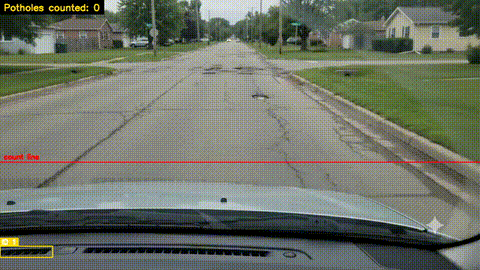

# 🕳️ Pothole Detection with YOLO26

A focused computer-vision pipeline that trains a **YOLO26** object detector to find potholes in road images and video, then serves it through a **FastAPI** API. Trained entirely on **CPU** (no GPU required).

> Single-class detector — the only class is `pothole` (id `0`).

---

## 📸 Demo

### Image detection (before → after)

| Input | Detected |
|---|---|
|  |  |

### Video detection (before → after)

Original clip:



Annotated output — each pothole gets a tracker ID and is counted once as it crosses the counting line:



<details>
<summary>▶️ Full-quality video (click to expand)</summary>

Original:

<video src="assets/sample_video_before.mp4" controls width="480"></video>

Annotated:

<video src="assets/sample_video_after.mp4" controls width="480"></video>

</details>

> The GIFs above are a 6-second preview and render in any Markdown viewer (VS Code, GitHub, etc.) with no push required. The full-length `.mp4` files play via the `<video>` tags once this repo is pushed to GitHub — GitHub renders those inline; most local Markdown previewers (including VS Code's) block local video playback for security reasons even though the file is there.

---

## ✨ Features

- Train a YOLO26-nano pothole detector from a Pascal-VOC-annotated dataset
- Single-image inference with confidence scores + numbered bounding boxes
- Video inference with **object tracking** so the same pothole isn't counted twice across frames
- FastAPI endpoints (`/detect`, `/detect_video`) with built-in Swagger UI for quick testing
- Fully reproducible, CPU-only training pipeline

---

## 🧱 Tech Stack

| Layer | Tools |
|---|---|
| Model | YOLO26 (Ultralytics), trained on CPU |
| API | FastAPI, Uvicorn |
| Tracking | Ultralytics ByteTrack (`tracker_pothole.yaml`) |
| Data prep | OpenCV, Pascal VOC → YOLO conversion |
| Dataset source | Kaggle: `chitholian/annotated-potholes-dataset` |

---

## 📊 Results

Trained for 50 epochs (early-stopped, best model at epoch 40) — **~1.93 hours** on an Intel i5-10210U (CPU only, no GPU).

| Split | Images | Instances | Precision | Recall | mAP50 | mAP50-95 |
|---|---|---|---|---|---|---|
| Validation | 107 | 305 | 0.741 | 0.666 | 0.745 | 0.448 |
| **Test** | 133 | 299 | 0.736 | 0.643 | **0.703** | 0.422 |

- **Inference speed (CPU):** ~67 ms / image
- **Model size:** YOLO26-nano — 122 layers, ~2.38M parameters, 5.2 GFLOPs

**Metric glossary**
- **Precision** — of all predicted potholes, how many were correct
- **Recall** — of all real potholes, how many were found
- **mAP50** — mean Average Precision at IoU 0.50 (lenient overlap)
- **mAP50-95** — mAP averaged over IoU 0.50→0.95 (strict; rewards tight boxes)

---

## 📁 Project Structure

```
object_detection_with_yolo_26_pothole_detection/
├── assets/                      # Demo images/video used in this README
├── annotated-images/            # Raw dataset: img-NNN.jpg + img-NNN.xml (VOC)
├── splits.json                  # Original train/test filename split (from Kaggle)
├── exp.ipynb                    # Downloads the raw dataset via kagglehub
├── prepare_yolo_dataset.py      # Converts VOC XML -> YOLO format, builds pothole_dataset/
├── pothole_dataset/             # Training-ready dataset (created by the script above)
│   ├── train/{images,labels}/
│   ├── val/{images,labels}/
│   └── test/{images,labels}/
├── dataset.yaml                 # Dataset config passed to YOLO (paths + class names)
├── train.py                     # Trains YOLO26n and evaluates on the test set
├── infer.py                     # Run inference on a single image
├── pothole_count.py             # Count + number potholes across an image/folder
├── pothole_count_video.py       # Count unique potholes in a video via line-crossing
├── tracker_pothole.yaml         # ByteTrack tracker config
├── runs/                        # YOLO outputs: weights, metrics, sample predictions
│   └── pothole_yolo26n/weights/best.pt   # Trained model (use this for inference)
└── backend/                     # FastAPI service that serves the model
│   ├── main.py
│   ├── detector.py
│   └── requirements.txt
```

---

## ⚙️ Setup

### 1. Clone and create an environment

```bash
git clone <your-repo-url>
cd object_detection_with_yolo_26_pothole_detection
python3 -m venv .venv
source .venv/bin/activate
```

### 2. Get the dataset

Run the cells in `exp.ipynb` — it pulls the **"Annotated Potholes Image Dataset"** from Kaggle via `kagglehub` into `annotated-images/`. You'll need a Kaggle account/API token configured (`kagglehub` will prompt you).

### 3. Build the YOLO-format dataset

```bash
pip install -r requirements.txt
python3 prepare_yolo_dataset.py
```

This converts the Pascal VOC XML annotations into normalized YOLO `.txt` labels, splits the data into `train/val/test`, and generates `pothole_dataset/` + `dataset.yaml`.

| Split | Images | Source |
|---|---|---|
| train | 425 | 80% of original train set |
| val | 107 | 20% of original train set (held out) |
| test | 133 | original test set, untouched |

---

## 🚀 How to Run

### Train the model

```bash
python3 train.py
```

Trains `yolo26n.pt` for 50 epochs at `imgsz=416` (tuned for CPU speed), then automatically evaluates the best checkpoint on the test split. Best weights land at:

```
runs/pothole_yolo26n/weights/best.pt
```

To try a bigger/more accurate variant, edit `MODEL_WEIGHTS` in `train.py` (`yolo26s.pt`, `yolo26m.pt`, `yolo26l.pt`, `yolo26x.pt`).

### Run inference on a single image

```bash
python3 infer.py test_image.jpg
python3 infer.py test_image.jpg --conf 0.45 --show
```

Prints each detection's confidence + box coordinates and saves an annotated image to `runs/detect/predict/`.

### Count potholes in an image or a folder of images

```bash
python3 pothole_count.py test_image.jpg
python3 pothole_count.py path/to/folder --conf 0.3
```

Saves numbered detections (1, 2, 3…) to `runs/pothole_count/`.

### Count unique potholes in a video

```bash
python3 pothole_count_video.py pothole.mp4 --conf 0.25 --vid-stride 2
```

Uses object tracking + a counting line so a pothole approaching the camera across many frames is only counted once. Output video saved to `runs/pothole_count_video/`.

### Run the FastAPI demo/API

```bash
cd backend
pip install -r requirements.txt
uvicorn main:app --reload --host 0.0.0.0 --port 8000
```

The API auto-loads `runs/pothole_yolo26n/weights/best.pt`. Use a different checkpoint with:

```bash
POTHOLE_WEIGHTS=/path/to/best.pt uvicorn main:app --port 8000
```

**Endpoints**

| Method | Path | Description |
|---|---|---|
| GET | `/health` | Status + weights path |
| POST | `/detect` | Upload an image → count + annotated image (base64) |
| POST | `/detect_video` | Upload a video → annotated video (unique count in `X-Pothole-Count` header) |

Open `http://localhost:8000` in the browser. It redirects to the FastAPI docs UI, where you can test `/detect` and `/detect_video` by uploading files.

```bash
# image
curl -X POST "http://localhost:8000/detect?conf=0.45" \
  -F "file=@test_image.jpg"

# video
curl -D - -X POST "http://localhost:8000/detect_video?conf=0.25&vid_stride=3" \
  -F "file=@pothole.mp4" -o detected.mp4
```

## 🧠 About YOLO26

YOLO26 (Ultralytics) is used here in its plain **detection** variant. Key improvements over prior YOLO versions:

- End-to-end inference without NMS (non-max suppression) → lower latency
- Simplified detection head (drops Distribution Focal Loss complexity)
- MuSGD optimizer + Progressive Loss + STAL during training
- Up to ~43% faster CPU inference than its predecessor (nano variant)

---

## 🔮 Possible Improvements

- Use a larger model (`yolo26s`/`yolo26m`) for higher accuracy if a GPU is available
- Train at the default `imgsz=640` instead of `416` for finer detail
- Add data augmentation / collect more images to improve recall
- Increase `EPOCHS`/`PATIENCE` if validation metrics are still climbing
- Tune the inference confidence threshold to balance precision vs. recall for your deployment scenario

---

## 🙏 Acknowledgements

Dataset: [**Annotated Potholes Image Dataset**](https://www.kaggle.com/datasets/chitholian/annotated-potholes-dataset) on Kaggle, by `chitholian`.
